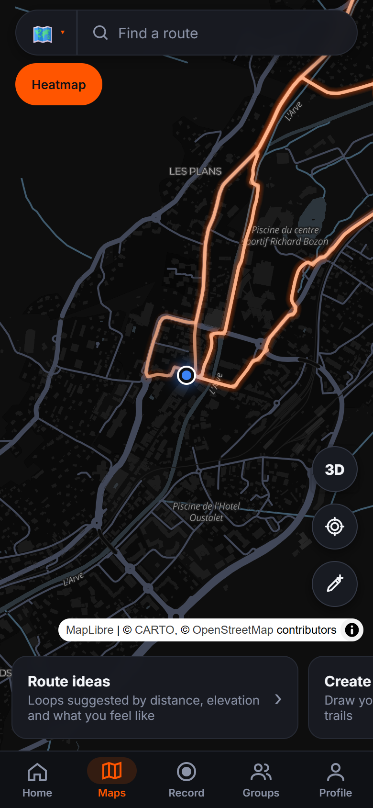
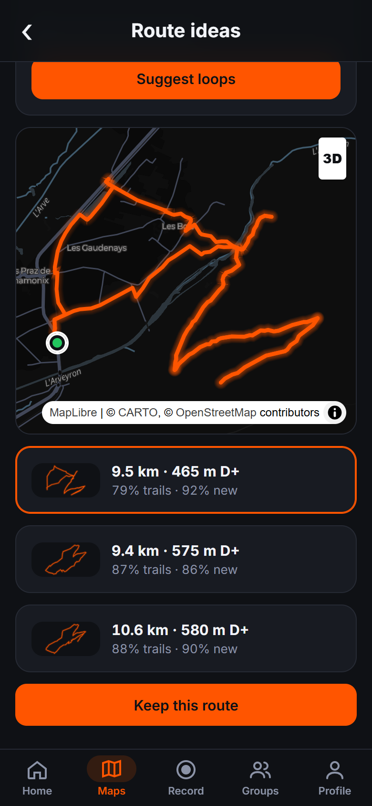
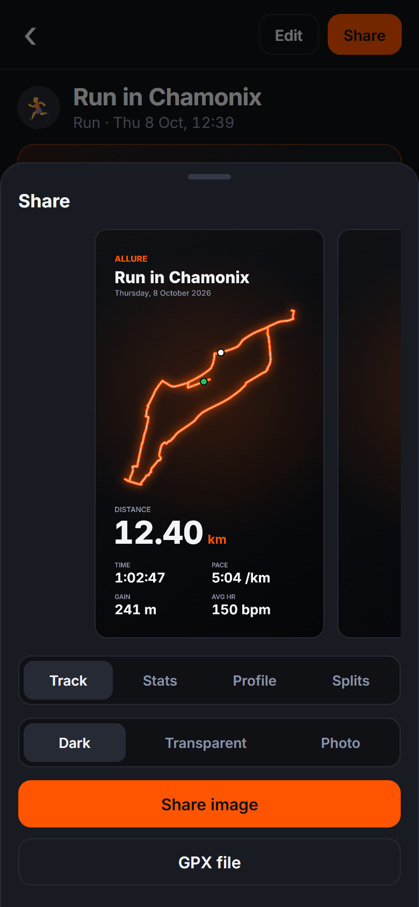
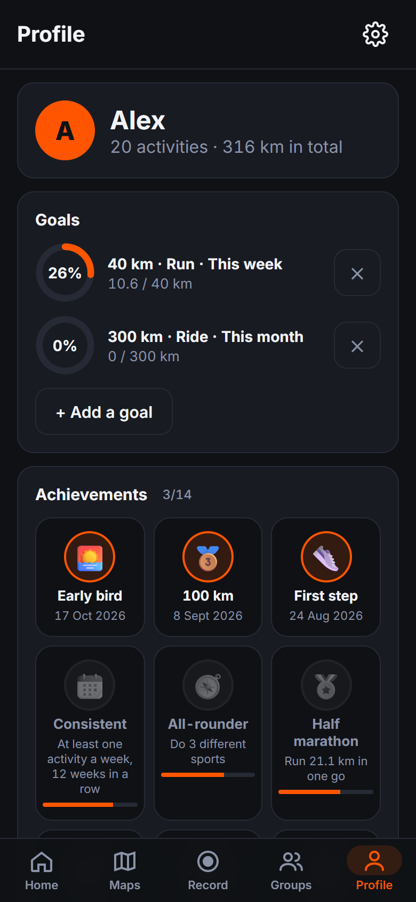
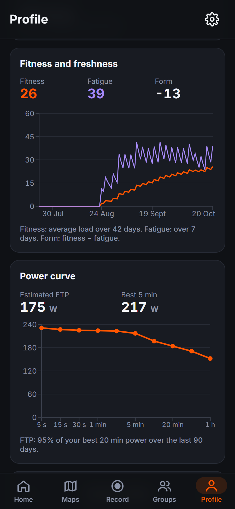

<h1 align="center">▲ Allure</h1>

<p align="center">
  <b>Record, analyze and share your runs, rides and hikes.</b><br>
  An open-source, local-first endurance training app for Android (iOS next).
</p>

<p align="center">
  <a href="LICENSE"></a>
  
  
</p>

<p align="center">
  
  
  
</p>
<p align="center">
  
  
  
</p>
<p align="center">
  
  
  
</p>

Allure aims at the feature set of the big fitness-tracking apps, including what they keep
behind a subscription (segments, route builder, heatmaps, training load, structured
workouts), as free software. Your activities stay on your phone: no account, no server of
ours, no tracking.

> **Status:** early development. Everything below works in the browser today. The Android
> app runs the same code, but its native parts (screen-off recording, Bluetooth, Health
> Connect) have not been validated on a device yet, and the app is not on the Play Store.
> The data format may still change. The interface is available in English and French.

## Contents

- [Features](#features)
- [Quick start](#quick-start)
- [Android app](#android-app)
- [Development tips](#development-tips)
- [Tech stack](#tech-stack)
- [Project structure](#project-structure)
- [Your data](#your-data)
- [Contributing](#contributing)
- [Acknowledgements](#acknowledgements)
- [License](#license)

## Features

**Record**
- Live GPS recording with a 3-2-1 countdown, auto-pause, laps and crash-safe autosave
- Customizable live screen: pick the big metric and the fields, per sport, with or
  without the map
- Voice announcements every split or every few minutes, with the fields you choose, and a
  high heart-rate alert
- Structured workouts: warm-up, reps and recovery, followed live with spoken prompts
- Follow a planned route (distance left, off-route alert) and live segments against your
  record
- Bluetooth heart-rate straps, cadence sensors and power meters
- Manual entry for activities without GPS (gym, treadmill, pool)

**Analyze**
- Distance, moving and elapsed time, pace or speed, elevation, heart rate, calories,
  grade-adjusted pace (GAP)
- Elevation and heart-rate chart scrubbed by touch, synced with a 2D or 3D map
- Splits, best efforts, personal records, race predictions
- Heart-rate zones and Relative Effort (perceived exertion when there is no heart rate)
- Cycling power: power curve, FTP estimate
- Intervals from laps or auto-detected efforts, matched activities on the same route
- Crop an activity, correct its elevation with terrain data

**Train**
- Fitness and freshness (CTL / ATL / TSB), training log, weekly and yearly totals
- Goals per sport (distance, time, elevation, count) with progress rings
- Achievements and monthly challenges, plus challenges with friends shared as a link
- Gear: shoe and bike mileage with wear alerts

**Maps and routes**
- Route builder snapped to roads and trails, with elevation profile and GPX export
- Suggested loops from your position: distance, flat or hilly, road or trails, new ground
- Personal heatmap of every activity
- Offline maps for saved routes
- Segments: create them from an activity, every matching effort is ranked

**Share and stay safe**
- Story images in four templates, over a dark, transparent or photo background
- Photos on activities, GPX export, system share sheet
- Privacy zones hide the start and end of your tracks around home on shared images and files
- Emergency contacts, a check-in when you stop moving, and an SOS button that prepares an
  SMS with your position

**Import and keep your data**
- `.gpx`, `.tcx`, `.fit` (also gzipped), indoor files without GPS, or a whole Strava
  bulk-export archive (`.zip`), with duplicate detection
- Health Connect on Android: workouts and heart rate from your watch
- Full backup to a file and restore on another phone

**Make it yours**
- English or French, metric or imperial units
- Dark, light or system theme, accent color, map style

See the [roadmap](docs/ROADMAP.md) for what is done and what comes next (accounts and
sync, live location sharing, store release).

## Quick start

Requirements: [Node.js](https://nodejs.org) 22 or newer.

```sh
git clone https://github.com/Cobbrou/Allure.git
cd Allure
npm install
npm run dev     # http://localhost:5173
```

Open the app, then either import your own files (button or drag and drop) or tap
**Generate a demo history** on the empty feed to get 20 sample activities.

```sh
npm test        # unit tests (node:test, no framework)
npm run build   # production build in dist/
```

## Android app

The Android app is the same web code inside a [Capacitor](https://capacitorjs.com) shell.
You need [Android Studio](https://developer.android.com/studio), which brings the Android
SDK and Java.

```sh
npm run android        # build the web app and copy it into android/
npm run android:open   # open the project in Android Studio, then Run
```

Run it on a phone in developer mode (USB debugging) or on an emulator. Screen-off
recording, Bluetooth sensors and Health Connect use native plugins; they still need to be
tested on real devices ([release checklist](docs/RELEASE.md)).

## Development tips

- **Simulated GPS:** open `http://localhost:5173/?sim=5#/record` to replay a demo run at
  5× speed instead of using the real GPS (dev builds only).
- **Phone layout:** the app is designed for a ~390 px wide portrait screen. In a desktop
  browser, use the device toolbar of the dev tools.
- **Separate data:** IndexedDB is per origin, so a second dev server
  (`npx vite --port 5174`) starts with an empty database.
- **Tests:** domain logic lives in `src/lib/` as pure functions, each with tests in
  `tests/`.

## Tech stack

| Area | Choice |
|---|---|
| UI | React 18, plain JavaScript, plain CSS (design tokens in `src/styles/global.css`) |
| Build | Vite |
| Maps | MapLibre GL JS with CARTO basemaps, AWS Terrain Tiles for 3D relief |
| Charts | Recharts |
| Storage | IndexedDB, through `src/lib/db.js` only |
| Routing | [BRouter](https://brouter.de) (OpenStreetMap) for the route builder and suggestions |
| Files | Garmin FIT SDK; hand-written GPX, TCX, CSV and ZIP readers |
| Native shell | Capacitor 8 (Android): background geolocation, Bluetooth LE, Health Connect |
| Tests | `node:test` and `node:assert` |

Why these choices: [docs/DECISIONS.md](docs/DECISIONS.md).

## Project structure

```
src/
  App.jsx            routes, app state, import
  pages/             one screen per route (feed, activity, record, maps, profile…)
  components/        reusable UI (StatMetric, ActivityCard, TrackMap, BottomSheet…)
  lib/               pure domain logic (analysis, records, training, segments, routes…)
                     + platform modules wrapping device APIs (db, location, sensors, share…)
  styles/global.css  design tokens and all styles
tests/               node:test files for src/lib
android/             Capacitor Android project
docs/                roadmap, architecture, decisions, release checklist, screenshots
```

More detail, including the data model and storage migrations:
[docs/ARCHITECTURE.md](docs/ARCHITECTURE.md).

## Your data

Allure is local-first. Activities, routes, segments and settings live in your browser's or
phone's storage. There is no account, no analytics and no server of ours. The app only
talks to these third-party services, which see your IP address:

- **CARTO** basemap tiles, to draw maps (the area shown)
- **Amazon Web Services** terrain tiles, for the 3D view and to correct the elevation of
  your recordings (the area of the track)
- **BRouter** (`brouter.de`), when you build or request a route (its waypoints)
- **Google Fonts**, for the Inter typeface

The full privacy policy is in the app (Settings → Privacy policy). Back up your data from
Settings → My data: uninstalling the app (or clearing the site data) deletes everything.
Cloud sync is on the [roadmap](docs/ROADMAP.md).

## Contributing

Contributions are welcome: bug reports, ideas, code and translations.

1. Open an issue first for anything larger than a small fix, so we can agree on the
   approach.
2. Fork, create a branch, and keep the change focused.
3. Run `npm test` and `npm run build`, and check the screens you touched at phone width.
4. Open a pull request describing what changed and why.

Project conventions:

- **English** for code, comments, docs, commits and PRs. UI strings are written in French
  in the source, wrapped in `t('…')`, with their English version in `src/lib/en.js`
  (`npm test` fails on a missing one).
- **Commits** follow [Conventional Commits](https://www.conventionalcommits.org):
  `feat(maps): add offline tiles`, `fix(record): keep laps after a crash`.
- **Mobile first**: touch targets of at least 44 px, nothing reachable only by hover,
  safe areas respected, every animation covered by `prefers-reduced-motion`.
- **Pure logic in `src/lib/`** with a test for every non-trivial function. Device APIs go
  through the platform modules so they can be swapped for native plugins.
- **SI units internally** (meters, seconds, ms timestamps); convert only for display.
- **No new dependency** when a few lines or a platform API do the job. Discuss it in the
  issue first.
- **Colors** come from the design tokens, never hard-coded in components.

## Acknowledgements

- Map data © [OpenStreetMap](https://www.openstreetmap.org/copyright) contributors (ODbL)
- Basemap © [CARTO](https://carto.com/attributions)
- Relief from [Terrain Tiles](https://registry.opendata.aws/terrain-tiles/) (Mapzen, AWS
  Open Data)
- Routing by [BRouter](https://github.com/abrensch/brouter); the demo loops were routed
  with the FOSSGIS OSRM server
- Built with [MapLibre GL JS](https://maplibre.org), [React](https://react.dev),
  [Recharts](https://recharts.org), [Capacitor](https://capacitorjs.com) and the
  [Garmin FIT SDK](https://developer.garmin.com/fit/)

Allure is an independent project. It is not affiliated with, endorsed by or connected to
Strava, Garmin or any other fitness company. Strava is a trademark of Strava, Inc.; the
name only appears here to describe file compatibility and inspiration.

## License

Copyright © 2026 Cobbrou.

Allure is free software: you can redistribute it and/or modify it under the terms of the
[GNU General Public License](LICENSE) as published by the Free Software Foundation, either
version 3 of the License, or (at your option) any later version.
